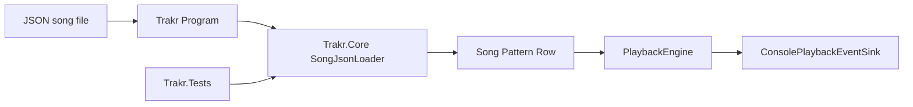

# Requirements

### Overview & Goals
Plan the next change as a new `song-loading` capability: load `Song` definitions from JSON files, let `src/Trakr/Program.cs` run an external song instead of a hard-coded one, and record the chosen architecture and decisions in a new root-level `GUIDE.md`.

### Scope
#### In Scope
- Introduce a new OpenSpec capability for loading songs from a JSON snapshot format.
- Keep file-path and file-system concerns in `src/Trakr`, but place JSON parsing and `Song` construction in `src/Trakr.Core`.
- Map JSON data onto the existing `Song`, `Pattern`, `Row`, `ChannelEvent`, and `EffectCommand` types, including sparse channel slots and row-start effects.
- Update `src/Trakr/Program.cs` to load a checked-in demo JSON song, with an optional first command-line argument to override the path.
- Add automated tests for successful loads, malformed input, and semantic validation failures.
- Create `GUIDE.md` in the solution root to document the loader architecture, JSON contract, and design decisions.

#### Out of Scope
- Binary tracker imports such as `S3M`.
- Writing/exporting songs back to disk.
- New playback semantics beyond what `song-playback` already supports.
- Terminal UI or audio-output work.

### User Stories
- As a developer, I want to describe a demo song in a file so I can change playback input without recompiling `Program.cs`.
- As a future host author, I want the parsing logic in `Trakr.Core` so non-console entry points can reuse song loading.
- As a maintainer, I want the decisions and architecture captured in `GUIDE.md` so the first input pipeline is easy to extend later.

### Functional Requirements
- The system must load a valid JSON song file into a fully validated `Song` instance before playback starts.
- The JSON shape must support song transport settings, order data, patterns, rows, per-channel note/instrument/volume fields, and optional effect commands.
- Sparse rows and sparse channels must remain representable without forcing placeholder note data.
- Syntax errors, missing required structural fields, and semantic rule violations must fail fast with actionable exceptions instead of falling through to partial playback.
- `src/Trakr/Program.cs` must be able to run the checked-in sample JSON song without source edits and optionally accept a file path override.
- `GUIDE.md` must explain the module boundaries, loading flow, JSON contract, and why parsing lives in `Trakr.Core` while file access stays in `Trakr`.

# Technical Design

### Current Implementation
- `src/Trakr.Core/Song.cs`, `Pattern.cs`, `Row.cs`, `ChannelEvent.cs`, and `EffectCommand.cs` define a compact in-memory tracker model with constructor validation but no serialization layer.
- `src/Trakr.Core/PlaybackEngine.cs` and `src/Trakr.Tests/PlaybackEngineTests.cs` already establish the core pattern used in this repo: behavior lives in `Trakr.Core`, and focused tests verify it without involving the console host.
- `src/Trakr/Program.cs` is still the composition root and currently hard-codes a demo `Song` before sending playback events to `src/Trakr/ConsolePlaybackEventSink.cs`.
- `src/Trakr/Trakr.csproj` references `Trakr.Core` only; there is no content file configuration or loader-specific dependency surface yet.
- `openspec/specs/song-playback/spec.md` documents playback behavior only; there is no separate capability for input/loading.
- No `GUIDE.md` currently exists at the solution root, so the documentation deliverable will be a new file.

### Key Decisions
- Create a new capability, `song-loading`, rather than extending `song-playback`, because this change introduces a new input pipeline instead of changing playback semantics.
- Use a JSON snapshot as the first loadable format because it maps directly to the existing model and keeps the initial parser smaller than a custom text grammar or tracker-like import format.
- Keep file reading and path resolution in `src/Trakr/Program.cs`, but move JSON parsing and model construction into `Trakr.Core` so tests and future hosts can reuse it.
- Reuse the existing model constructors for semantic validation instead of duplicating playback rules in a separate validation layer.
- Add a dedicated loader test file in `src/Trakr.Tests` rather than overloading `PlaybackEngineTests.cs` with parsing concerns.
- Treat `GUIDE.md` as part of the change, not an afterthought: it should capture the architecture that this first file-input pipeline introduces.

### Proposed Changes
- Add a small loader surface in `Trakr.Core` that accepts JSON content from the host and returns a validated `Song`.
- Introduce internal JSON contract types or parsing helpers in `Trakr.Core` so transport settings, patterns, rows, and channel effects can be decoded without leaking JSON concerns into `Song` itself.
- Update `src/Trakr/Program.cs` so it resolves a file path, opens the JSON file, delegates parsing to `Trakr.Core`, and then reuses the existing playback engine and `ConsolePlaybackEventSink` unchanged.
- Check in a sample JSON song and configure `src/Trakr/Trakr.csproj` so the sample is available when running the console app locally.
- Add `GUIDE.md` at the repo root to document the chosen JSON format, the host/core boundary, and how this loader fits with future formats that are still out of scope today.

### Data Models / Contracts
- Recommended loader surface in `Trakr.Core`:
  - `SongJsonLoader.Load(Stream stream)` returns `Song`
  - Optional overload: `SongJsonLoader.Load(string json)` for test ergonomics if it reduces fixture noise
- Recommended JSON shape:
  ```json
  {
    "initialSpeed": 6,
    "initialTempo": 125,
    "order": [0, 1],
    "patterns": [
      {
        "rows": [
          {
            "channels": [
              { "note": 48, "instrument": 1, "effect": { "code": "A", "parameter": 3 } },
              null
            ]
          }
        ]
      }
    ]
  }
  ```
- Contract rules:
  - `patterns`, `rows`, and `channels` preserve the existing nested model shape.
  - Channel entries may be `null` to represent sparse tracker cells.
  - `effect.code` remains a string so existing `EffectCommand` normalization continues to apply.
  - Semantic rules such as invalid order references or invalid `Bxx`/`Dxx` targets remain enforced by `Song` construction.

### File Structure
- Add `GUIDE.md` at the solution root.
- Add loader code under `src/Trakr.Core/` such as `SongJsonLoader.cs` and any internal JSON contract/helper files it needs.
- Modify `src/Trakr/Program.cs` to switch from in-memory song construction to file-backed loading.
- Modify `src/Trakr/Trakr.csproj` to include the checked-in sample JSON file as content.
- Add a sample song file under `src/Trakr/` or another repo-local runtime location used by the console app.
- Add a dedicated test file such as `src/Trakr.Tests/SongJsonLoaderTests.cs`.

### Architecture Diagram


### Risks
- JSON field optionality can drift away from the core model if the contract is too loose; keep the first schema close to the existing constructor shape.
- Error handling can become inconsistent if the loader mixes syntax and semantic failures; let parsing surface structural issues and let `Song` keep enforcing model rules.
- Sample-file path handling can be brittle across `dotnet run` and test environments; keep the host path logic small and document it clearly in `GUIDE.md`.

# Testing

### Validation Approach
- Add focused loader tests in `src/Trakr.Tests/SongJsonLoaderTests.cs` that construct songs from JSON without involving console output.
- Reuse the existing playback engine as an integration backstop by loading the sample JSON and verifying it can still drive the current console playback flow.
- Validate the documentation output by checking that `GUIDE.md` reflects the implemented file paths, boundaries, and JSON contract.

### Key Scenarios
- Load a minimal valid JSON song with one pattern and one row.
- Load a JSON song that contains sparse channel slots and effect commands.
- Reject malformed JSON or missing top-level arrays such as `order` or `patterns`.
- Reject semantically invalid payloads that the existing `Song` constructor already disallows, including bad order references and invalid flow-control targets.
- Run `src/Trakr/Program.cs` against the checked-in sample file and confirm playback still traces through the existing sink.

### Edge Cases
- Empty patterns that are valid for playback normalization but still require correct JSON decoding.
- Rows with different channel populations across patterns.
- Effect codes with mixed casing that should normalize through `EffectCommand`.
- File-path override behavior when the user supplies a relative path versus relying on the bundled sample.

### Test Changes
- Add `SongJsonLoaderTests.cs` for parsing/validation coverage.
- Keep `PlaybackEngineTests.cs` focused on playback semantics unless one end-to-end loader scenario is needed to prove the loaded model behaves correctly.
- Use `dotnet test` for automated verification and `dotnet run --project src\Trakr\Trakr.csproj` for a final manual smoke check with the sample JSON.

# Delivery Steps

### ✓ Step 1: Add a reusable JSON loading boundary in `Trakr.Core`
`Trakr.Core` can construct a validated `Song` from JSON input without depending on file-system paths.
- Add `SongJsonLoader` and any internal JSON contract/helper types under `src/Trakr.Core`.
- Map JSON transport, order, pattern, row, channel, and effect data onto the existing model types.
- Route semantic validation through the current `Song` and `EffectCommand` constructors instead of duplicating rule logic.
- Add focused unit coverage in `src/Trakr.Tests/SongJsonLoaderTests.cs` for valid and invalid payloads.

### ✓ Step 2: Wire the console host to external song files
Running `src/Trakr` loads playback input from JSON rather than hard-coded song construction.
- Update `src/Trakr/Program.cs` so it resolves a default sample path and optionally accepts a first-argument override.
- Add a checked-in sample JSON song and configure `src/Trakr/Trakr.csproj` so the file is available at runtime.
- Reuse the existing `PlaybackEngine` and `ConsolePlaybackEventSink` flow after loading completes.
- Confirm the sample JSON still exercises the current playback behavior already covered in `song-playback`.

### ✓ Step 3: Document the architecture and lock down end-to-end behavior
The repository includes durable guidance for the new loader architecture and a verified end-to-end song-loading path.
- Create `GUIDE.md` in the solution root documenting the host/core boundary, JSON contract, extension points, and the key decisions chosen for this first loader.
- Make sure `GUIDE.md` references the concrete implementation files added or modified by the change.
- Run the automated tests and a console smoke run to verify the sample file loads and plays successfully.
- Keep the documentation aligned with the final code paths and runtime assumptions so future changes can extend the loader cleanly.