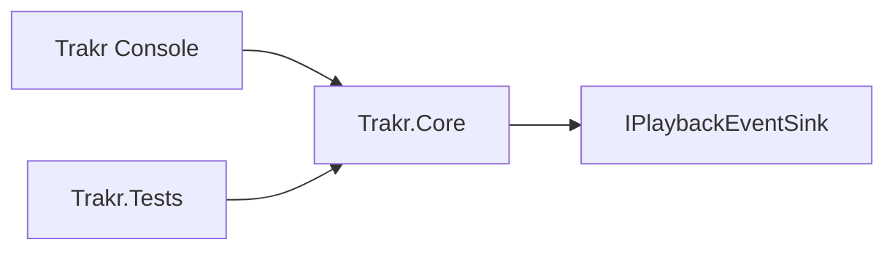

# Requirements

### Overview & Goals
Establish the first implementation slice for `Trakr` as an architecture-first tracker prototype: a testable core model and playback/transport engine, a thin console host, and no real audio yet.

### Scope
#### In Scope
- Revise `IDEA.md` so it no longer promises full `S3M` support up front.
- Introduce a dedicated `src/Trakr.Core` library for tracker domain and sequencing logic.
- Keep `src/Trakr` as a console shell that traces playback state.
- Keep APIs flexible enough to represent `S3M`-style concepts later without implementing full format support now.
- Add unit tests in `src/Trakr.Tests` for sequencing and transport behavior.

#### Out of Scope
- `S3M` file parsing or export.
- Real audio output or `NAudio` integration.
- Full tracker UI or `Terminal.Gui` integration.
- Full effect semantics beyond extension points and simple stubs.

### Functional Requirements
- The core must model song structure at least at the level of song, pattern, row, channel event, and effect placeholder.
- The transport must advance through ticks/rows/pattern flow deterministically.
- The console app must be able to run a small in-memory song and print traceable playback state.
- IO and playback side effects must sit behind interfaces so unit tests can exercise the core without real audio or console dependencies.

# Technical Design

### Current Implementation
- `IDEA.md` is the current product definition and is still too ambitious about `S3M` support.
- `src/Trakr/Program.cs` is the default `Hello, World!` entry point.
- `src/Trakr/Trakr.csproj` is a `net10.0` console app.
- `src/Trakr.Tests/Trakr.Tests.csproj` is an xUnit project, and `src/Trakr.Tests/UnitTest1.cs` is only a placeholder.
- `trakr.slnx` currently contains only the app and test projects.

### Key Decisions
- Create `src/Trakr.Core` now, rather than embedding domain logic in `src/Trakr`, so sequencing and model code remain isolated and testable.
- Treat `S3M` compatibility as a data-model and API-shape concern for now, not a promise of full playback behavior.
- Defer real audio entirely; use trace/stub outputs so transport and effect-dispatch seams can be validated first.
- Keep the console app thin: compose a sample song, run the transport loop, and render state transitions.

### Proposed Changes
- Rewrite the `IDEA.md` wording to state that early versions aim for future-friendly `S3M`-style APIs, not complete support.
- Add `Trakr.Core` with immutable or mostly immutable domain types such as `Song`, `Pattern`, `Row`, `ChannelEvent`, and `EffectCommand`.
- Add a transport/playback service in `Trakr.Core` that owns tempo/tick progression, row advancement, and event dispatch.
- Define narrow seams for side effects, such as a playback sink / trace sink interface, so the engine reports note/effect activity without depending on console or audio libraries.
- Replace `Program.cs` with a minimal composition root that creates a demo song, runs the engine, and prints trace output.
- Replace `UnitTest1.cs` with focused tests for tick advancement, row progression, pattern boundaries, and effect placeholder dispatch.

### Data Models / Contracts
- `Song`: ordered collection of patterns plus initial timing settings.
- `Pattern`: ordered rows.
- `Row`: per-channel event slots.
- `ChannelEvent`: note/instrument/volume/effect data, allowing partially populated tracker-style cells.
- `EffectCommand`: value object or discriminated shape that preserves effect identity and parameters even when behavior is stubbed.
- `IPlaybackEventSink` (name illustrative): receives transport/note/effect events for tracing now and audio adaptation later.

### File Structure
- Modify `IDEA.md`.
- Modify `trakr.slnx` to include `src/Trakr.Core/Trakr.Core.csproj`.
- Add `src/Trakr.Core/...` for domain and transport code.
- Modify `src/Trakr/Trakr.csproj` to reference `Trakr.Core`.
- Modify `src/Trakr/Program.cs` to host the trace-driven prototype.
- Modify `src/Trakr.Tests/Trakr.Tests.csproj` to reference `Trakr.Core`.
- Replace `src/Trakr.Tests/UnitTest1.cs` with targeted transport/domain tests.

### Architecture Diagram

### Risks
- Over-modeling too early could slow the first slice; keep the domain focused on sequencing needs, not every future tracker feature.
- If effect modeling is too concrete, later `S3M`-style behaviors may be awkward; preserve raw command/parameter capacity even when execution is stubbed.
- Console tracing can accidentally become business logic; keep formatting outside the transport engine.

# Testing

### Validation Approach
- Use xUnit in `src/Trakr.Tests` to validate the core without console or audio dependencies.
- Keep the console trace slice small enough to sanity-check manually from the app entry point.

### Key Scenarios
- Advancing ticks until a row boundary is reached.
- Advancing rows until a pattern boundary is reached.
- Emitting note/effect events to the sink in deterministic order.
- Preserving stubbed effect commands in the model even when no real behavior exists yet.

### Edge Cases
- Empty or sparse row data.
- Pattern end handling.
- Multiple channels producing events on the same row.
- Unsupported effect commands being forwarded as placeholders rather than rejected.

# Delivery Steps

### ✓ Step 1: Reframe the project scope and solution layout
The repo documents an architecture-first tracker scope and includes a dedicated core library in the solution.
- Update `IDEA.md` to replace the current full-`S3M` wording with future-friendly API goals and explicit non-goals for early versions.
- Add `src/Trakr.Core/Trakr.Core.csproj` and include it in `trakr.slnx`.
- Wire project references so `src/Trakr` and `src/Trakr.Tests` can depend on `Trakr.Core` without pulling console concerns into the core.

### ✓ Step 2: Implement the tracker domain and transport engine in Trakr.Core
`Trakr.Core` exposes the first testable tracker model and deterministic playback/transport flow.
- Add core model types for song structure, row/channel events, and effect placeholders that can evolve toward `S3M`-style capabilities later.
- Implement the timing/transport logic that advances ticks, rows, and pattern flow.
- Add a narrow side-effect boundary such as a playback or trace sink interface so the engine reports events without knowing about audio or console output.
- Cover the transport and event-dispatch behavior with focused xUnit tests in `src/Trakr.Tests`.

### ✓ Step 3: Add a trace-only console prototype on top of the core
Running `src/Trakr` executes a small in-memory tracker sequence and prints playback state transitions.
- Replace the template `Program.cs` with a composition root that builds a demo song and runs the core transport loop.
- Implement a console-backed sink or renderer that prints row/tick/note/effect activity for manual inspection.
- Keep the console host thin and ensure all sequencing decisions remain inside `Trakr.Core`.
- Verify the traced output matches the transport expectations already covered by unit tests.