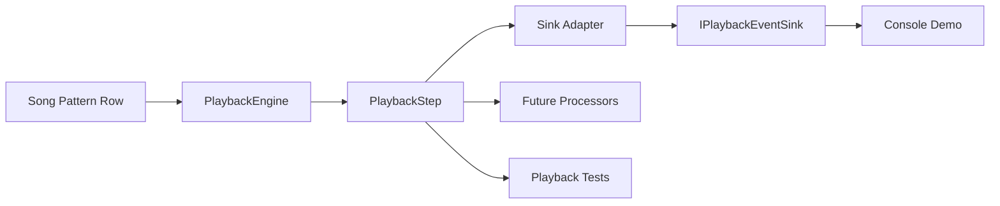

# Requirements

### Overview & Goals
Refactor playback sequencing so `src/Trakr.Core/PlaybackEngine.cs` stays focused on deterministic transport while exposing a per-tick result object that other components can compose around.

### Scope
**In Scope**
- Add a `PlaybackStep`-style API in `src/Trakr.Core` that represents one playable tick using existing model data from `PlaybackPosition`, `Row`, `ChannelEvent`, and `EffectCommand`.
- Refactor `PlaybackEngine` so step generation and sink dispatch are separated.
- Preserve current observable playback behavior: position advancement, completion, empty-pattern skipping, and deterministic row/channel/effect ordering.
- Keep the console demo in `src/Trakr/Program.cs` and `src/Trakr/ConsolePlaybackEventSink.cs` working through a compatibility path.
- Expand `src/Trakr.Tests/PlaybackEngineTests.cs` to validate both the new result-object path and the legacy sink behavior.
- Update OpenSpec materials for `song-playback` if the public playback contract changes.

**Out of Scope**
- Implementing effect semantics, pattern jump/break logic, or audio playback.
- Redesigning `Song`, `Pattern`, `Row`, `ChannelEvent`, or `EffectCommand` beyond what the new step contract needs.
- Removing `IPlaybackEventSink` immediately if existing app/test code still depends on it.

### Functional Requirements
- The engine must expose one structured playback result per successful tick.
- The structured result must contain enough information to reproduce the current sink callback sequence for that tick.
- Existing callback-based consumers must continue to be supportable during the refactor.
- Repeated stepping after completion must remain a no-op with no additional playback content.
- The design must leave a clear seam for future processors that inspect or transform tick results without embedding those rules in `PlaybackEngine`.

# Technical Design

### Current Implementation
- `src/Trakr.Core/PlaybackEngine.cs` now keeps transport state (`_orderIndex`, `_rowIndex`, `_tick`) and exposes both the legacy `Step()` path and the additive `TryStep(out PlaybackStep? step)` result-object path.
- `src/Trakr.Core/PlaybackStep.cs`, `PlaybackStepChannelEvent.cs`, and `PlaybackStepEffect.cs` model one playable tick, while `src/Trakr.Core/PlaybackStepEventSinkAdapter.cs` replays a structured step into any `IPlaybackEventSink`.
- `src/Trakr.Core/IPlaybackEventSink.cs` and `src/Trakr.Core/NullPlaybackEventSink.cs` remain unchanged, which preserves the callback compatibility surface for existing consumers.
- `src/Trakr/Program.cs` now drives playback through `TryStep(...)` and dispatches each result through `PlaybackStepEventSinkAdapter`, while `src/Trakr/ConsolePlaybackEventSink.cs` remains a pure sink implementation.
- `src/Trakr.Tests/PlaybackEngineTests.cs` now validates transport progression, structured step contents, adapter replay order, empty-pattern skipping, and completion behavior.

### Key Decisions
- Introduce a new per-tick result model in `src/Trakr.Core` instead of teaching `IPlaybackEventSink` new semantics.
- Keep `PlaybackEngine` as the owner of transport progression only; step-result creation remains inside the engine, but interpretation stays outside the engine.
- Preserve the current callback API as a compatibility layer by having `Step()` delegate through `PlaybackStepEventSinkAdapter`, so existing sink-based code keeps its behavior.
- Use the additive public API `TryStep(out PlaybackStep? step)` as the direct structured-result seam for future processors and adapters.

### Implemented Shape
- `PlaybackEngine.TryStep(...)` creates a `PlaybackStep` from the current `Position`, `Speed`, `Tempo`, and row data before advancing transport state.
- Non-zero ticks produce a tick-only `PlaybackStep`, while tick-zero row starts include the `Row`, ordered `PlaybackStepChannelEvent` entries, and ordered `PlaybackStepEffect` entries.
- `PlaybackEngine.Step()` now calls `TryStep(...)` and dispatches the resulting step through `PlaybackStepEventSinkAdapter`, preserving `OnTick` -> `OnRow` -> `OnChannelEvent` -> `OnEffect` ordering.
- `src/Trakr/Program.cs` uses the structured-step path explicitly, which demonstrates the new seam without changing `ConsolePlaybackEventSink`.
- `src/Trakr.Tests/PlaybackEngineTests.cs` verifies structured-step contents and separately verifies that adapter replay preserves legacy ordering.
- `openspec/specs/song-playback/spec.md` now documents the structured per-tick result surface while keeping the existing sequencing requirements intact.

### Data Models / Contracts
- `PlaybackStep`
  - `PlaybackPosition Position`
  - `int Speed`
  - `int Tempo`
  - `bool IsRowStart`
  - `Row? Row`
  - `IReadOnlyList<PlaybackStepChannelEvent> ChannelEvents`
  - `IReadOnlyList<PlaybackStepEffect> Effects`
- `PlaybackStepChannelEvent`
  - `int ChannelIndex`
  - `ChannelEvent ChannelEvent`
- `PlaybackStepEffect`
  - `int ChannelIndex`
  - `EffectCommand Effect`
- Compatibility contract:
  - `PlaybackEngine.Step()` remains available for current callers and dispatches the same callback order through `PlaybackStepEventSinkAdapter`.
  - `PlaybackEngine.TryStep(out PlaybackStep? step)` exposes the structured result directly for future processors/adapters.

### File Structure
- Modified `src/Trakr.Core/PlaybackEngine.cs`
- Added `src/Trakr.Core/PlaybackStep.cs`
- Added `src/Trakr.Core/PlaybackStepChannelEvent.cs`
- Added `src/Trakr.Core/PlaybackStepEffect.cs`
- Added `src/Trakr.Core/PlaybackStepEventSinkAdapter.cs`
- Modified `src/Trakr/Program.cs`
- Left `src/Trakr/ConsolePlaybackEventSink.cs` unchanged as the compatibility sink implementation
- Modified `src/Trakr.Tests/PlaybackEngineTests.cs`
- Modified `openspec/specs/song-playback/spec.md`

### Architecture Diagram

### Risks
- If `PlaybackStep` mirrors sink callbacks too literally, it may become a callback transcript instead of a durable domain result; keep it fact-based and ordered, not presentation-oriented.
- If `Step()` and the new stepping API diverge, callback and result-object paths could drift; both should flow through the same step-construction code.
- Over-modeling future processors now would add abstraction without current use; start with a single result object and one adapter seam.

# Testing

### Validation Approach
- Validate `src/Trakr.Tests/PlaybackEngineTests.cs` against both the structured-step path and the legacy sink-driven path.
- Keep a compatibility test that replays a generated step through a recording sink and compares the emitted order with current expectations.
- Run `dotnet test 'trakr.slnx'` to confirm the transport, adapter, and demo-facing compatibility behavior all remain green.

### Key Scenarios
- A step result from tick zero contains row, channel, and effect payloads in the same order the sink currently observes.
- Non-zero ticks produce tick-only step results while preserving the same position advancement as today.
- Playback still advances across row boundaries, pattern boundaries, and empty patterns exactly as current tests assert.
- Completion still prevents additional playable results after the final row.

### Edge Cases
- Empty channel entries remain excluded from row-start payload collections.
- Leading or intermediate empty patterns still normalize to the next playable row before producing a step.
- The compatibility adapter does not emit row/channel/effect callbacks on non-zero ticks.

# Delivery Steps

### ✓ Step 1: Introduce structured playback-step models in Trakr.Core
`Trakr.Core` exposes a new per-tick playback result that can describe the same facts the engine currently emits through sink callbacks.
- Add `PlaybackStep` and any minimal supporting payload types under `src\Trakr.Core`.
- Define the result around existing domain objects such as `PlaybackPosition`, `Row`, `ChannelEvent`, and `EffectCommand` rather than new behavior-heavy abstractions.
- Keep the model focused on transport facts needed by tests, adapters, and future processors.

### ✓ Step 2: Refactor PlaybackEngine to generate step results and preserve sink compatibility
`PlaybackEngine` produces structured steps internally while existing callback-based callers continue to work.
- Rework `src\Trakr.Core\PlaybackEngine.cs` so tick result creation and cursor advancement are separated.
- Add an additive stepping API that returns the structured result without forcing an immediate breaking change to `Step()`.
- Introduce or wire a small adapter that replays each generated step into `IPlaybackEventSink` so `ConsolePlaybackEventSink` and existing callers keep their current behavior.

### ✓ Step 3: Update app, tests, and spec coverage around the new seam
The console demo, unit tests, and spec baseline all reflect the new `PlaybackStep` seam while preserving current playback behavior.
- Update `src\Trakr\Program.cs` and, if useful, `src\Trakr\ConsolePlaybackEventSink.cs` to use the new flow or the compatibility adapter explicitly.
- Expand `src\Trakr.Tests\PlaybackEngineTests.cs` to assert both structured-step content and legacy sink ordering.
- Update `openspec\specs\song-playback\spec.md` only where the public playback contract now includes the structured step surface.