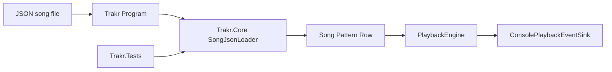

# Trakr Guide

## Overview

Trakr now has two distinct responsibilities:

- `src/Trakr.Core` owns the in-memory tracker model, validation, JSON-to-model mapping, and playback behavior.
- `src/Trakr` is the console host that resolves file paths, opens files, and routes loaded songs into the playback engine.

This split keeps the first file-input pipeline reusable for future hosts while leaving environment-specific concerns in the app layer.

## Loader architecture



### Host boundary

`src/Trakr/Program.cs` is responsible for:

- choosing the default sample file path (`demo-song.json` in the output directory)
- accepting an optional first command-line argument as a file-path override
- checking that the chosen file exists
- opening the file stream and handing JSON parsing off to `Trakr.Core`

The host does not parse JSON or construct `Song`, `Pattern`, or `Row` instances directly anymore.

### Core boundary

`src/Trakr.Core/SongJsonLoader.cs` is responsible for:

- decoding the JSON snapshot format
- validating required JSON structure such as `initialSpeed`, `initialTempo`, `order`, `patterns`, `rows`, and `channels`
- mapping JSON data onto `Song`, `Pattern`, `Row`, `ChannelEvent`, and `EffectCommand`
- reusing existing model validation in `Song` and `EffectCommand` for semantic rules

That last point is intentional: structural JSON problems fail inside the loader, while semantic song problems continue to fail inside the existing model constructors.

## JSON contract

The first supported format is a JSON snapshot that mirrors the current in-memory song model closely.

```json
{
  "initialSpeed": 6,
  "initialTempo": 125,
  "order": [0, 1],
  "patterns": [
    {
      "rows": [
        {
          "channels": [
            { "note": 48, "instrument": 1, "effect": { "code": "A", "parameter": 3 } },
            null
          ]
        }
      ]
    }
  ]
}
```

### Top-level fields

- `initialSpeed`: required integer
- `initialTempo`: required integer
- `order`: required integer array of pattern indices
- `patterns`: required array of pattern objects

### Nested fields

- each pattern requires `rows`
- each row requires `channels`
- each channel entry may be either a channel object or `null`
- channel objects may contain `note`, `instrument`, `volume`, and `effect`
- `effect`, when present, requires `code` and `parameter`

### Sparse data rules

- Use `null` in `channels` to represent sparse tracker cells.
- Patterns may contain zero rows, which preserves the existing playback normalization behavior for empty ordered patterns.
- Rows may contain different channel counts, matching the current in-memory model.

### Effect rules

- Effect codes stay as strings in JSON.
- `EffectCommand` uppercases codes during construction, so mixed-case JSON effect codes normalize automatically.
- Playback semantics for supported effects still come from `PlaybackEngine`; the loader only creates the model.

## Error handling

The loader separates failures into two categories:

- malformed JSON or missing required structural fields produce fast loader failures from `SongJsonLoader`
- semantically invalid songs, such as bad order references or invalid flow-control targets, still fail through `Song`

This keeps the input contract strict without duplicating playback validation rules in multiple places.

## Runtime files

- `src/Trakr/demo-song.json` is the checked-in sample file used by the console app.
- `src/Trakr/Trakr.csproj` copies that file to the output directory with `CopyToOutputDirectory="PreserveNewest"`.
- Running `dotnet run --project src\Trakr\Trakr.csproj` uses the bundled sample automatically.
- Running `dotnet run --project src\Trakr\Trakr.csproj -- <path>` uses the first argument as an override path.

Relative override paths resolve from the current working directory. The default bundled sample path resolves from `AppContext.BaseDirectory` so the console app can find the copied file after build.

## Key implementation files

- `src/Trakr.Core/SongJsonLoader.cs`
- `src/Trakr.Core/Song.cs`
- `src/Trakr/Program.cs`
- `src/Trakr/Trakr.csproj`
- `src/Trakr/demo-song.json`
- `src/Trakr.Tests/SongJsonLoaderTests.cs`

## Extension points

This loader is intentionally the smallest reusable input boundary:

- new hosts can call `SongJsonLoader` without referencing console-only code
- future formats can add new loader entry points in `Trakr.Core` while reusing the same `Song` model and playback engine
- binary tracker imports such as `S3M` remain out of scope until the project needs a richer import layer

If the project later needs multiple source formats, the next clean evolution is to keep file access in the host and add additional format-specific loaders in `Trakr.Core` rather than pushing parsing back into `Song` or `Program.cs`.